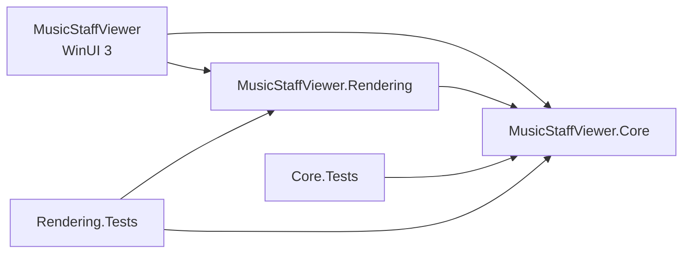
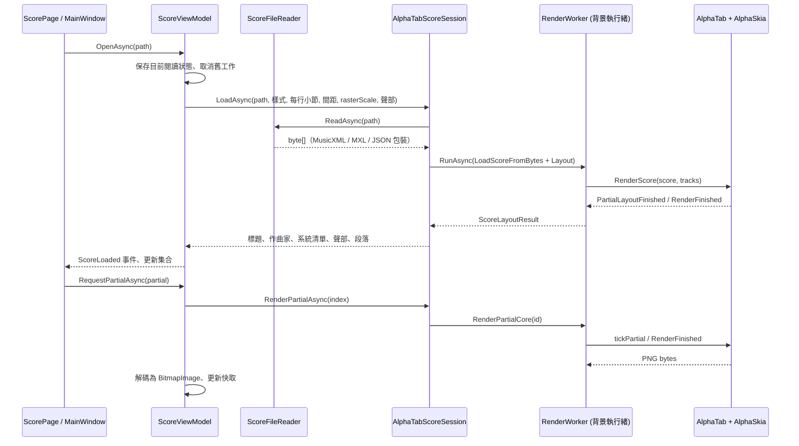

# MusicStaffViewer 系統架構與技術文件

本文件說明 MusicStaffViewer 的技術選型、專案分層、渲染管線、執行緒模型、資料流與部署架構，供維護者與進階使用者參考。功能層面的設計決策請參閱 [DESIGN.md](DESIGN.md)。

---

## 1. 技術基線

| 項目 | 內容 |
| --- | --- |
| 語言 | C# 14（nullable、file-scoped namespace） |
| 執行環境 | .NET 10 |
| UI 框架 | WinUI 3（Windows App SDK 1.8） |
| UI 架構 | MVVM（CommunityToolkit.Mvvm）＋ Microsoft.Extensions.Hosting 依賴注入 |
| 樂譜引擎 | AlphaTab 1.9.0（.NET 版） |
| 繪圖橋接 | AlphaSkia 4.0.157／AlphaSkia.Native.Windows 4.0.157 |
| PDF | SkiaSharp 3.119.2（`SKDocument.CreatePdf`） |
| 目標平台 | `net10.0-windows10.0.19041.0`，最低 Windows 10 1809（17763） |
| 架構 | x64 與 ARM64（framework-dependent 發佈） |
| 封裝 | 未封裝（unpackaged，`WindowsPackageType=None`） |
| 測試 | xUnit 2.9.3 |

### 1.1 為何選用 AlphaTab .NET

- 原生 .NET 實作，可直接在 C# 內完成 MusicXML 解析與版面計算，不需要 WebView2、JavaScript 或瀏覽器執行環境。
- 提供 lazy rendering 與 partial API，適合只繪製可見系統的大型總譜。
- 支援 .mxl、MusicXML 與多聲部，並內建 Bravura 音樂字型。

### 1.2 為何使用 AlphaSkia 而非直接以 SkiaSharp 排版

AlphaTab 的 Skia 後端透過 AlphaSkia 產生點陣影像。AlphaSkia 是 AlphaTab 生態系的 Skia 綁定，可確保 AlphaTab 的繪圖指令與實際輸出相容；SkiaSharp 只用於把已產生的 PNG 重新解碼並寫入 PDF。

---

## 2. 專案結構

```text
win-musicstaff-01/
├─ MusicStaffViewer.sln
├─ Directory.Build.props          # 共用版本與編譯設定
├─ Directory.Packages.props       # 集中套件版本
├─ src/
│  ├─ MusicStaffViewer.Core/      # 平台無關核心：模型、檔案讀取、設定、視窗狀態
│  │  ├─ Models/                  # AppSettings、ScoreDocument、列舉與顯示選項
│  │  ├─ MusicXml/                # ScoreFileReader、ScoreMetadataReader
│  │  └─ Services/                # UserSettingsService、WindowStateService
│  ├─ MusicStaffViewer.Rendering/ # 樂譜排版與繪製、PDF 匯出
│  │  ├─ AlphaTabScoreSession.cs  # 載入、排版、partial 繪製
│  │  ├─ RenderWorker.cs          # 單一背景執行緒佇列
│  │  ├─ PdfExporter.cs           # 多頁 PDF 輸出
│  │  └─ ScoreLayoutResult.cs     # 排版結果與中繼資料
│  └─ MusicStaffViewer/           # WinUI 3 應用程式
│     ├─ App.xaml(.cs)            # 啟動、DI、單一實例、日誌
│     ├─ MainWindow.xaml(.cs)     # 視窗、選單、快捷鍵、主題、視窗狀態
│     ├─ Views/                   # ScorePage、SettingsPage、AboutPage
│     ├─ ViewModels/              # ScoreViewModel 與各項目 ViewModel
│     ├─ Services/                # ThemeService、FileLoggerProvider
│     ├─ Helpers/                 # 轉換器
│     ├─ Styles/                  # 共用樣式與主題資源
│     ├─ Strings/zh-Hant/         # 繁體中文資源字串
│     └─ Assets/                  # 應用程式圖示
└─ tests/
   ├─ MusicStaffViewer.Core.Tests/
   └─ MusicStaffViewer.Rendering.Tests/
```

### 2.1 相依方向



- `Core` 不依賴 WinUI 或 AlphaTab，可獨立測試。
- `Rendering` 只依賴 AlphaTab／AlphaSkia／SkiaSharp 與 `Core`。
- `MusicStaffViewer` 是唯一包含 UI 與平台 API 的專案，負責組裝服務與呈現畫面。

---

## 3. 啟動與相依注入

`App` 建構時使用 `Host.CreateDefaultBuilder()` 建立主機，註冊：

| 服務 | 生命週期 | 用途 |
| --- | --- | --- |
| `ScoreFileReader` | Singleton | 讀取與驗證樂譜檔 |
| `ScoreMetadataReader` | Singleton | 讀取標題／作曲家（含檔案快取） |
| `UserSettingsService` | Singleton | 載入與儲存 `settings.json` |
| `Func<AlphaTabScoreSession>` | Transient | 每次載入建立獨立渲染工作階段 |
| `ScoreViewModel` | Singleton | 應用程式層狀態與操作 |
| `ScorePage`、`SettingsPage`、`AboutPage` | Singleton | 頁面與對話框內容 |
| `ThemeService` | Singleton | 主題與標題列配色 |
| `MainWindow` | Singleton | 主視窗 |

日誌僅使用自訂的 `FileLoggerProvider`，輸出到 `%LocalAppData%\MusicStaffViewer\logs`。

### 3.1 單一實例與檔案轉交

1. 使用 `AppInstance.FindOrRegisterForKey("Com.Example.MusicStaffViewer")` 判斷是否為第一個實例。
2. 非第一個實例會嘗試把命令列中的樂譜路徑，透過具名管道（`MusicStaffViewer.<user>.<session>.OpenFile`）送給既有實例，再呼叫 `RedirectActivationToAsync` 並結束。
3. 第一個實例在背景執行具名管道伺服器；收到路徑後在 UI 執行緒開啟樂譜。
4. 管道使用 `PipeOptions.CurrentUserOnly`，避免其他使用者連線。

---

## 4. 樂譜載入與渲染管線



### 4.1 `ScoreFileReader`

- 驗證副檔名為 `.musicxml`、`.xml`、`.mxl`。
- `.mxl` 直接回傳原始位元組，交由 AlphaTab 解壓。
- 一般 `.xml`：跳過 BOM 與空白；若內容是 JSON 且含 `musicxml` 字串欄位，取出內嵌 MusicXML；否則必須以 `<` 開頭。
- 所有 I/O 使用非同步 API 並支援 `CancellationToken`。

### 4.2 `AlphaTabScoreSession`

主要職責：

1. 以 `ScoreLoader.LoadScoreFromBytes` 解析樂譜。
2. 建立 AlphaTab `Settings`：
   - `Core.Engine = "skia"`
   - `Core.EnableLazyLoading = true`
   - `Display.LayoutMode = Page`
   - `Display.BarsPerRow = 每行小節數`
   - `Display.Scale = rasterScale`
   - `Display.SpacingRatio = 音符間距比例`
   - 依深色／淺色紙張設定音符、譜線、小節線顏色
3. 以 `Width = 1600 × rasterScale` 排版，並把 partial 的座標除以 `rasterScale` 還原成 DIP。
4. 透過 `PartialLayoutFinished` 收集每個 partial 的位置與尺寸。
5. 以反射讀取 AlphaTab 內部的 `Layout.Systems`，區分「頁首」與「實際系統」，並取得每個系統的第一／最後小節索引。
6. 裁掉頁首下方多餘留白，把座標正規化到內容左上角。
7. 產生 `ScoreLayoutResult`（標題、作曲家、系統、聲部、段落、小節總數）。

`SplitPartials` 使用反射是因為 AlphaTab 1.9 沒有公開 partial 與 master bar 的對應 API。此處以位置與高度比對第一個系統，再依序對應；若結構不符則退回全部 partial 皆視為系統（沒有頁首）。

### 4.3 partial 繪製與快取

- `RenderPartialCore(id)` 會訂閱 `RenderFinished`，比對 `RenderFinishedEventArgs.Id`，取得該 partial 的 PNG。
- `ScoreViewModel` 以 `LinkedList` 維護最多 16 個已解碼 partial 的 LRU 快取；超出時釋放影像參照。
- 已繪製的 id 記錄在 `_renderedIds`，狀態列可顯示「已繪製 n/N 個系統」。
- 可見系統進入畫面時呼叫 `RequestPartialAsync`；下一個系統則由 `PrefetchPartialAsync` 預先繪製。

### 4.4 高解析度重繪

1. 基準解析度由「樂譜品質」決定（1.5×／2.0×／3.0×）。
2. 依目前縮放與 DPI 計算目標解析度（上限 2.5×／4.0×），以 0.5 為級距。
3. 當目標高於基準時，建立第二個 `AlphaTabScoreSession`（`_highResSession`），以更高 rasterScale 重新排版。
4. 可見系統先顯示基準影像，再於背景升級為高解析度版本；捲動停止後有防抖延遲，避免每一步縮放都重繪。
5. 舊影像解碼會比對 `DecodedZoom` 與 `SourceRasterScale`，避免重複解碼與記憶體浪費。

### 4.5 執行緒模型

- **UI 執行緒**：WinUI 控制項、`BitmapImage` 解碼、集合更新。
- **RenderWorker**：每個 `AlphaTabScoreSession` 擁有專屬的單一背景執行緒與 `BlockingCollection<Action>`。AlphaTab 的 renderer 不是執行緒安全的，因此所有排版與繪製都序列化在同一執行緒。
- **檔案／metadata I/O**：`Task.Run` 或非同步 I/O，不阻塞 UI。
- 所有載入流程以 `_generation` 與 `CancellationTokenSource` 防止舊結果覆蓋新狀態。

> 由於 `BitmapImage.SetSourceAsync` 必須在 UI 執行緒建立與設定，PNG 解碼流程留在 UI 執行緒，但只處理已縮放至目標尺寸的影像，並以 `DecodePixelWidth` 限制解碼大小。

---

## 5. UI 與 MVVM 結構

| 元件 | 職責 |
| --- | --- |
| `MainWindow` | 選單、全域快捷鍵、全螢幕、主題套用、視窗大小／位置保存、最近檔案選單、ContentDialog 管理 |
| `ScorePage` | 樂譜呈現、側欄、工具列、縮放與捲動、拖放、聲部／目錄彈出、狀態列、PDF 匯出互動 |
| `ScoreViewModel` | 目前樂譜狀態、載入／重排／快取／閱讀位置、最愛與最近檔案、匯出 PDF |
| `ScorePartialViewModel` | 單一系統的版面尺寸、縮放後顯示尺寸、影像來源與載入狀態 |
| `ScoreTrackViewModel` | 聲部顯示名稱、選取狀態 |
| `ScoreSectionViewModel` | 目錄項目（小節索引與顯示文字） |
| `SettingsPage` | 偏好設定表單，支援「編輯中／套用／取消」 |
| `ThemeService` | 依顯示模式與介面主題設定資源筆刷與標題列按鈕顏色 |
| `FileLoggerProvider` | 有界佇列的非同步檔案日誌，保留 30 天 |

### 5.1 檢視與 ViewModel 的溝通

- ViewModel 透過 `INotifyPropertyChanged` 與 `ObservableCollection` 通知畫面。
- 載入／匯出等需協調畫面的事件以 `Action`／`Action<bool>` 暴露（例如 `ScoreLoaded`、`ScoreLoading`、`FavoritesChanging`）。
- 畫面只處理純 UI 行為（焦點、捲動、對話框、拖放），不直接操作 AlphaTab。

### 5.2 資源字串與主題

- 使用者可見文字放 `Strings/zh-Hant/Resources.resw`，以 `ResourceLoader` 或 `x:Uid` 取得。
- 主題顏色集中在 `Styles/Themes/`，由 `Styles/Shared.xaml` 定義 `AppBackgroundBrush` 等資源；`ThemeService` 在執行期更新筆刷顏色。
- `ThemeService` 同時設定視窗 `RequestedTheme` 與標題列按鈕顏色；跟隨系統時由 `UISettings.ColorValuesChanged` 觸發 300 ms 防抖後重新套用。

---

## 6. PDF 匯出架構

```text
ScoreViewModel.ExportPdfAsync(stream)
 ├─ 建立 PDF 用 AlphaTabScoreSession（依 PDF 品質 2×/3×/4×）
 ├─ 渲染頁首 partial（若有）
 ├─ 逐系統渲染 PNG → PdfSystem(Png, Width)
 ├─ PdfExporter.WriteSystemsAsync
 │   ├─ SKDocument.CreatePdf（標題、作者、Creator/Producer、300 DPI）
 │   └─ PageWriter：依紙張與邊界排版，必要時換頁
 └─ 回報進度（已處理系統數）
```

- `PdfExportOptions` 定義 A4／A3／Letter 尺寸、邊界 40 pt、系統間距 14 pt。
- 系統會依 `logicalWidth / maxLogicalWidth` 縮放繪製寬度，保留原始相對寬度；若超過可用高度則縮小至單頁高度。
- 影像以 `SKBitmap.Decode` 解碼後繪製，PDF 內容本質為點陣圖。
- 匯出流程使用獨立工作階段，不影響畫面上的縮放與快取。

---

## 7. 設定與狀態保存

### 7.1 `settings.json`

由 `UserSettingsService` 以 `System.Text.Json` 序列化，欄位包含：

- 顯示與主題：`DisplayMode`、`AccentTheme`、`SheetStyle`、`PdfPageSize`
- 縮放與版面：`InitialZoomMode`、`DefaultZoom`、`DefaultMeasuresPerSystem`、`NoteSpacing`
- 品質：`ScoreQuality`、`PdfQuality`
- 視窗：`Window`（位置、大小、最大化）
- 清單：`RecentFiles`（最多 10 筆且只保留存在的檔案）、`FavoriteFiles`
- 閱讀狀態：`ScoreViewStates`（最多 200 筆）、`LastScorePath`

讀取時會驗證列舉值、夾限數值範圍、去除重複路徑，並過濾已不存在的最近檔案。寫入採先寫暫存檔再取代，並以 `SemaphoreSlim` 避免並行寫入。

### 7.2 閱讀狀態 `ScoreViewState`

每個樂譜可保存：

- 縮放比例與是否為「符合寬度」
- 可見聲部索引
- 目前系統與系統內偏移
- 目前所在小節

重新開啟時優先還原至上次小節所在系統；若版面改變則以系統與偏移近似還原。

---

## 8. 錯誤處理與日誌

- 啟動與未處理例外會寫入 `fatal.log`（超過 1 MB 時輪替為 `fatal.log.1`）。
- 一般操作錯誤以 `ILogger<T>` 記錄，並在 UI 以 `InfoBar` 顯示友善訊息。
- 載入／重排／匯出都支援取消；切換樂譜時會取消上一筆工作。
- 檔案不存在、格式不支援、渲染失敗、PDF 開啟失敗等情況都有獨立訊息。

---

## 9. 發佈架構

| 項目 | 設定 |
| --- | --- |
| 發佈類型 | 非 Self-Contained（`SelfContained=false`），需 .NET 10 Desktop Runtime |
| Windows App SDK | `WindowsAppSDKSelfContained=true`，執行元件隨程式附帶 |
| 封裝 | 未封裝（`WindowsPackageType=None`） |
| RuntimeIdentifier | `win-x64`、`win-arm64` |
| 平台 | `x64`、`ARM64` |

ARM64 版需要 AlphaSkia 與 SkiaSharp 的 ARM64 原生程式庫。AlphaSkia.Native.Windows 自 4.0.157 起提供 `win-arm64`；本專案因此將 AlphaSkia 套件升級至 4.0.157，同時保留 AlphaTab 1.9.0。

建置與打包步驟詳見 [BUILD_AND_RELEASE.md](BUILD_AND_RELEASE.md)。

---

## 10. 測試架構

- `MusicStaffViewer.Core.Tests`：設定讀寫、路徑正規化、視窗位置夾限、檔案讀取、metadata 解析、顯示選項計算。
- `MusicStaffViewer.Rendering.Tests`：AlphaTab 排版、partial 繪製、PDF 輸出（含頁首）、深色紙張、聲部選擇等。
- 測試不啟動 WinUI，僅驗證可獨立運作的核心與渲染邏輯。

執行：

```powershell
dotnet test MusicStaffViewer.sln -c Debug -p:Platform=x64
```

---

## 11. 已知技術限制

- AlphaTab 內部 API（`Layout.Systems`、partial id）以反射取得，升版時需重新驗證。
- 固定 1600 DIP 寬度可確保一致的排版比例，但無法完全重現原譜印刷分頁。
- PDF 為點陣影像，檔案大小與品質成正比。
- 切換聲部需重新排版，總譜可能需要數秒。
- ARM64 版本尚待實機驗證。
