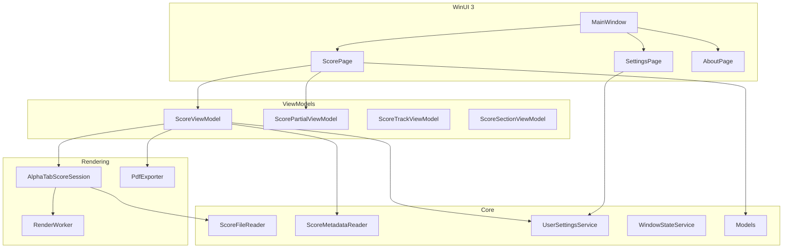
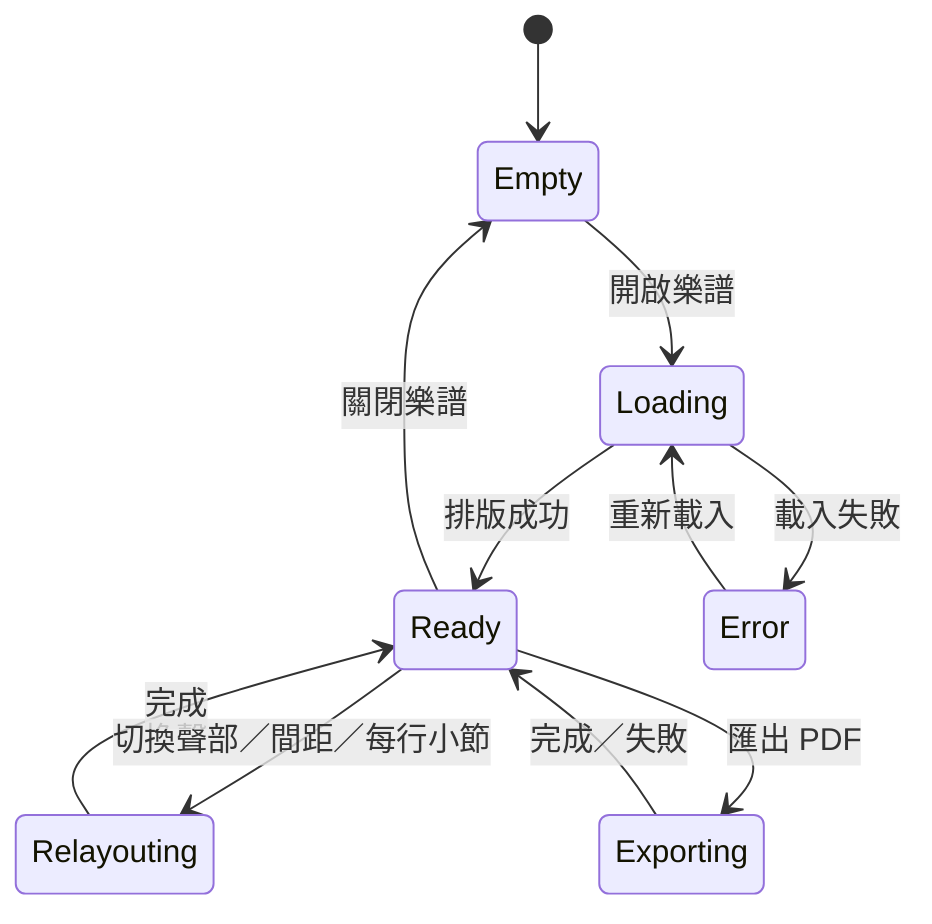
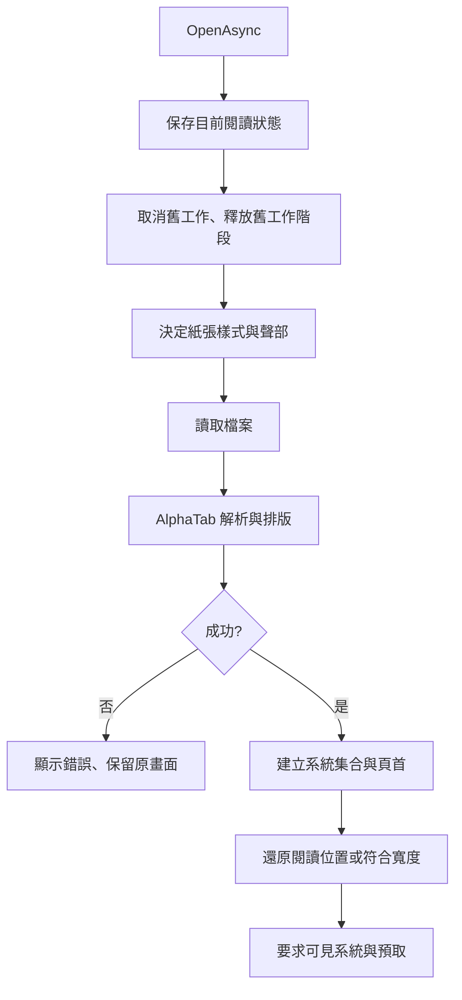

# MusicStaffViewer 系統設計文件

本文件描述產品需求、使用案例、模組設計、資料模型、畫面流程與設計決策。技術實作細節請參閱 [ARCHITECTURE.md](ARCHITECTURE.md)。

---

## 1. 目標與範圍

### 1.1 產品目標

提供一個 Windows 原生、免瀏覽器、可離線使用的 MusicXML 五線譜檢視器，讓使用者在練習、教學與排練時能快速開啟樂譜、舒適閱讀，並輸出可分享的 PDF。

### 1.2 範圍

**納入範圍**

- 開啟本機 MusicXML／MXL 樂譜。
- 大型總譜的漸進式渲染與流暢捲動。
- 縮放、符合寬度、全螢幕、聲部切換、小節與段落導覽。
- 最愛與最近檔案、閱讀位置續讀。
- 多頁 PDF 匯出。
- 顯示模式與五款介面主題。

**排除範圍**

- MIDI 播放、節拍器、移調。
- 樂譜編輯、註記、列印。
- 雲端同步、帳號、線上樂譜庫。
- MSIX 安裝程式或自動更新。

---

## 2. 使用者與情境

### 2.1 主要使用者

| 角色 | 需求 |
| --- | --- |
| 演奏／練習者 | 快速找到樂譜、放大閱讀、從上次位置續讀 |
| 教師 | 全螢幕展示、切換聲部、跳至指定小節 |
| 排練者 | 瀏覽大型總譜、匯出 PDF 給團員 |
| 一般使用者 | 拖放即開、清楚的錯誤提示、不污染系統 |

### 2.2 使用案例

| 編號 | 使用案例 | 主要流程 |
| --- | --- | --- |
| UC-01 | 開啟樂譜 | 選單／捷徑／拖放／命令列 → 驗證 → 載入 → 排版 → 顯示 |
| UC-02 | 閱讀與導覽 | 捲動、縮放、跳系統、跳小節、目錄跳轉 |
| UC-03 | 全螢幕展示 | F11 隱藏周邊 → 閱讀 → Esc 還原 |
| UC-04 | 切換聲部 | 勾選聲部 → 重排 → 還原閱讀位置 |
| UC-05 | 管理最愛 | 加入／移除最愛、側欄開啟、右鍵移除 |
| UC-06 | 匯出 PDF | 選擇位置 → 逐系統繪製 → 完成／開啟 |
| UC-07 | 調整偏好 | 開啟設定 → 修改 → 套用／取消 |
| UC-08 | 續讀 | 重新開啟樂譜 → 還原縮放、聲部、位置 |
| UC-09 | 單一實例轉交 | 第二次啟動帶檔 → 交給既有視窗 |

---

## 3. 功能設計

### 3.1 開啟與驗證

- 支援 `.musicxml`、`.xml`、`.mxl`。
- `.xml` 允許 UTF-8 BOM、前導空白與舊版 JSON 包裝（`{ "musicxml": "..." }`）。
- 檔案不存在或格式錯誤時，顯示可理解的錯誤訊息，不清除目前樂譜。
- 同一樂譜重複開啟時避免重複載入（外部轉交情境）。

### 3.2 版面與渲染

- 邏輯寬度固定 1600 DIP，系統依每行小節數（4–10）自動換行。
- 首頁標題區塊只在樂譜最上方顯示，不計入系統數。
- 只渲染可見系統，並預先準備下一個；高倍縮放時提高解析度重繪。
- 深色紙張時使用深底白譜，並同步調整頁首顏色。

### 3.3 縮放規則

| 操作 | 行為 |
| --- | --- |
| 放大／縮小 | 以 5% 級距調整，範圍 20%–400% |
| Ctrl+0 | 回到 100% |
| 符合視窗寬度 | 依可用寬度計算，視窗改變時重新計算 |
| Ctrl+滾輪 | 以畫面中心為錨點 |
| 按鈕縮放 | 保持樂譜水平／垂直置中 |

### 3.4 導覽

- 系統導覽以上／下一個系統為單位。
- 小節跳轉以 1–N 的 master bar 序號換算系統。
- 目錄只列出實際存在的 `Section`（段落／排練記號）。
- 狀態列同步顯示系統位置與小節範圍。

### 3.5 最愛與最近

- 最近檔案最多 10 筆，且只保留仍存在的檔案。
- 最愛依標題排序，允許檔案暫時不存在但保留記錄。
- 最愛清單更新時盡量就地更新，避免鍵盤焦點跳回第一筆。
- 最愛清單可收合，寬度 280 DIP／44 DIP。

### 3.6 PDF 匯出

- 依 PDF 品質（2×／3×／4×）建立獨立渲染工作階段。
- 第一頁先畫頁首（標題、作曲家、版權），再排系統。
- 每張紙可容納多個系統，必要時自動換頁。
- 顯示進度並在完成後提供開啟檔案選項。

### 3.7 設定

- 設定採「編輯 → 套用／取消」模式，未套用不寫入。
- 顯示模式與介面主題彼此獨立；每款主題都有淺色與深色配色。
- 樂譜樣式可跟隨顯示模式，或固定淺色／深色紙張。

---

## 4. 模組設計



### 4.1 模組職責與邊界

| 模組 | 負責 | 不負責 |
| --- | --- | --- |
| `MainWindow` | 視窗生命週期、選單、快捷鍵、主題、視窗狀態 | 樂譜內容與排版 |
| `ScorePage` | 樂譜呈現、互動、對話框、拖放 | 直接呼叫 AlphaTab |
| `ScoreViewModel` | 狀態協調、載入／重排／快取、匯出流程 | 控制項操作 |
| `AlphaTabScoreSession` | 解析、排版、partial 繪製 | UI 執行緒與影像顯示 |
| `PdfExporter` | 頁面排版與 PDF 寫入 | 取得樂譜內容 |
| `Core.Services` | 設定與視窗狀態持久化 | UI 與渲染 |

### 4.2 關鍵設計決策

| 決策 | 理由 | 取捨 |
| --- | --- | --- |
| 固定 1600 DIP 版面 | 不同視窗寬度下比例一致，縮放行為可預期 | 不重現原譜分頁 |
| Lazy partial 渲染 | 大型總譜也能快速開啟 | 需要快取與可見性判斷 |
| 獨立渲染執行緒 | AlphaTab renderer 非執行緒安全 | 所有繪製序列化，尖峰時需等待 |
| 雙工作階段（基準＋高解析） | 先快速顯示再提升清晰度 | 記憶體與排版成本增加 |
| PDF 使用點陣影像 | 直接重用已渲染 PNG，實作單純 | 檔案較大、非向量 |
| 設定先暫存後套用 | 避免誤改立即生效 | 需管理編輯狀態 |
| 單一實例＋具名管道 | 避免多視窗與重複載入 | 跨使用者／工作階段不轉交 |

---

## 5. 資料模型

### 5.1 主要型別

| 型別 | 說明 |
| --- | --- |
| `AppSettings` | 所有使用者設定與清單 |
| `WindowBounds` | 視窗位置、大小、最大化狀態 |
| `WorkArea` | 螢幕工作區，供位置夾限 |
| `ScoreDocument` | 樂譜檔案的路徑、標題、作曲家、是否目前樂譜 |
| `ScoreViewState` | 單一樂譜的縮放、聲部與閱讀位置 |
| `ScoreDisplayOptions` | 縮放範圍、間距比例、品質對應的 rasterScale |
| `ScoreLayoutResult` | 排版結果：標題、作曲家、尺寸、系統、頁首、聲部、段落、小節數 |
| `ScorePartialLayout` | 單一系統的 id、位置、尺寸、小節範圍 |
| `RenderedPartial` | 繪製後的 PNG 與小節範圍 |
| `PdfSystem` | PDF 用的 PNG 與邏輯寬度 |

### 5.2 `AppSettings` 欄位

| 欄位 | 型別 | 預設 | 說明 |
| --- | --- | --- | --- |
| `DisplayMode` | `DisplayMode` | `System` | 跟隨系統／淺色／深色 |
| `AccentTheme` | `AccentTheme` | `ClassicBlue` | 五款介面主題 |
| `SheetStyle` | `SheetStyle` | `FollowDisplay` | 樂譜紙張樣式 |
| `PdfPageSize` | `PdfPageSize` | `A4` | 匯出紙張 |
| `InitialZoomMode` | `InitialZoomMode` | `FitWidth` | 新樂譜初始縮放 |
| `DefaultZoom` | `double` | `1.0` | 自訂初始縮放 |
| `DefaultMeasuresPerSystem` | `int` | `6` | 每行小節數 |
| `NoteSpacing` | `NoteSpacing` | `Compact` | 音符間距 |
| `ScoreQuality` | `QualityLevel` | `High` | 畫面品質 |
| `PdfQuality` | `QualityLevel` | `High` | PDF 品質 |
| `Window` | `WindowBounds?` | `null` | 視窗狀態 |
| `RecentFiles` | `List<string>` | 空 | 最近檔案 |
| `FavoriteFiles` | `List<string>` | 空 | 最愛檔案 |
| `ScoreViewStates` | `List<ScoreViewState>` | 空 | 各樂譜閱讀狀態 |
| `LastScorePath` | `string?` | `null` | 上次開啟的樂譜 |

### 5.3 列舉

| 列舉 | 值 |
| --- | --- |
| `DisplayMode` | `System`、`Light`、`Dark` |
| `AccentTheme` | `EyeCareYellow`、`ClassicBlue`、`ForestGreen`、`TwilightPurple`、`NeutralGray` |
| `SheetStyle` | `FollowDisplay`、`Light`、`Dark` |
| `PdfPageSize` | `A4`、`A3`、`Letter` |
| `InitialZoomMode` | `FitWidth`、`Custom` |
| `NoteSpacing` | `Compact`、`Normal`、`Loose` |
| `QualityLevel` | `Standard`、`High`、`Maximum` |

---

## 6. 狀態與流程設計

### 6.1 畫面狀態



- **Empty**：顯示「開啟 MusicXML 以顯示樂譜」與拖放提示。
- **Loading**：顯示進度環與「正在排版樂譜…」。
- **Ready**：顯示系統、工具列與狀態列。
- **Error**：`InfoBar` 顯示錯誤，保留可重試狀態。
- **Exporting**：顯示匯出進度並停用部分操作。

### 6.2 載入流程



### 6.3 縮放與重繪流程

1. 使用者縮放 → 更新 `Zoom` 與每個 partial 的顯示尺寸。
2. 計算目標 rasterScale；若高於目前來源，安排高解析度升級。
3. 升級時建立或重用高解析度工作階段，重排後重新繪製可見系統。
4. 若縮放持續變動，以計時器防抖，只處理最後一次。

### 6.4 匯出流程

1. 檢查目前樂譜與是否已在匯出。
2. 建立 PDF 專用工作階段（依 PDF 品質）。
3. 渲染頁首（若有）與所有系統。
4. 交給 `PdfExporter` 分頁繪製並回報進度。
5. 成功後記錄 `_lastExportedPdf`，提供「開啟 PDF」。

---

## 7. UI 設計

### 7.1 版面

```text
┌─────────────────────────────────────────────┐
│ 選單列：檔案／設定／檢視／說明              │
├──────────┬──────────────────────────────────┤
│ 最愛樂譜 │ 工具列：縮小 放大 符合寬度 每行… │
│ （可收合）│──────────────────────────────────│
│          │ 樂譜內容（標題＋系統）           │
│          │                                  │
│          │                                  │
├──────────┴──────────────────────────────────┤
│ 狀態列：系統 n/N、小節範圍、已繪製進度      │
└─────────────────────────────────────────────┘
```

### 7.2 設計原則

- 以 WinUI 原生 Fluent 控制項為主，間距為 4 的倍數，圓角 8。
- 所有顏色來自主題資源，不在 XAML 寫死色碼。
-  destructive 操作（移除最愛）以右鍵選單執行，不需額外確認但可重新加入。
- 重要按鈕提供 `AutomationProperties.Name` 與工具提示。
- 空狀態、載入中、錯誤狀態皆有對應畫面。
- 最小視窗 900×600；全螢幕時隱藏非必要周邊。

### 7.3 無障礙

- 圖示按鈕具備可讀名稱與工具提示。
- 快捷鍵涵蓋主要操作。
- 最愛清單支援鍵盤上下鍵與焦點保留。
- 深色模式下維持足夠對比。

---

## 8. 非功能需求

| 類別 | 目標 |
| --- | --- |
| 效能 | 一般樂譜 3 秒內顯示首個系統；大型總譜以可見系統優先 |
| 記憶體 | partial 快取上限 16；高解析度影像依需要建立並釋放 |
| 穩定性 | 所有背景工作可取消；例外記錄不中斷程式 |
| 隱私 | 不連線、不上傳、不收集遙測 |
| 相容性 | Windows 10 1809 以上；x64 與 ARM64 |
| 可維護性 | Core／Rendering 可獨立測試；套件版本集中管理 |
| 可攜性 | 未封裝、免安裝、設定與日誌留在使用者設定檔 |

---

## 9. 測試策略

| 層級 | 範圍 | 工具 |
| --- | --- | --- |
| 單元測試 | 設定驗證、視窗夾限、檔案讀取、metadata、顯示選項 | xUnit |
| 整合測試 | AlphaTab 排版、partial 繪製、PDF 輸出 | xUnit |
| 手動測試 | UI 互動、縮放、拖放、全螢幕、主題、ARM64 實機 | 人工 |

驗證指令：

```powershell
dotnet test MusicStaffViewer.sln -c Debug -p:Platform=x64
dotnet format --verify-no-changes
```

---

## 10. 風險與限制

| 風險 | 影響 | 對策 |
| --- | --- | --- |
| AlphaTab 內部 API 變動 | 反射失效、系統對應錯誤 | 固定版本；升版時執行渲染測試 |
| 大型總譜排版耗時 | 切換聲部時等待 | 顯示狀態、保留閱讀位置、可取消 |
| 高解析度重繪耗用記憶體 | 低記憶體裝置可能變慢 | 限制快取數量與解碼尺寸 |
| PDF 檔案較大 | 分享不便 | 提供品質選項 |
| ARM64 原生相依 | 缺少原生程式庫 | AlphaSkia 4.0.157 提供 win-arm64；持續以實機驗證 |
| 未在 Windows 10 1809 實測 | 相容性未知 | 列為已知限制，後續補測 |

---

## 11. 後續發展

- 向量 PDF 輸出。
- 書籤／自訂練習段落。
- 雙頁並排與跨頁顯示。
- 列印功能。
- ARM64 與 Windows 10 1809 實機驗證。
